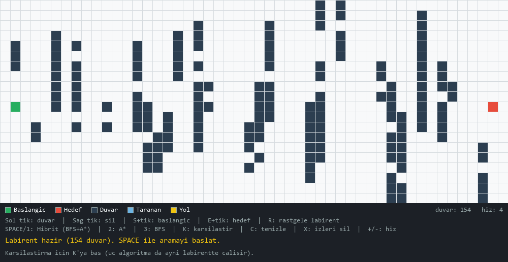
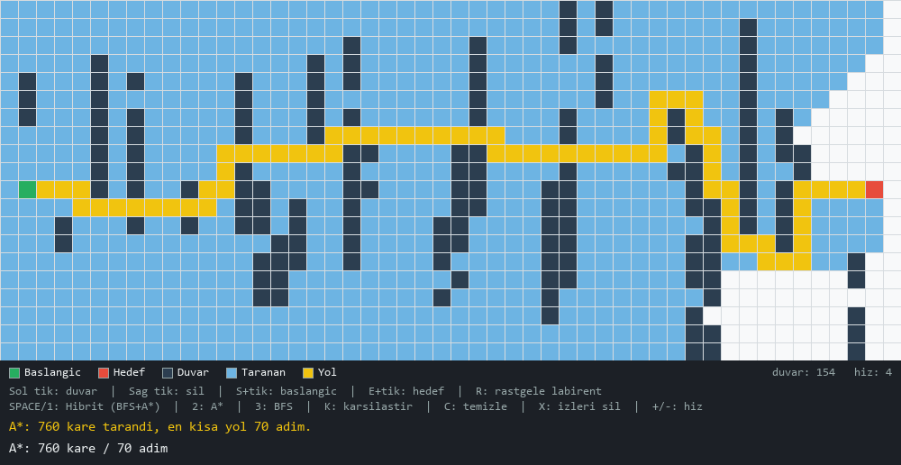
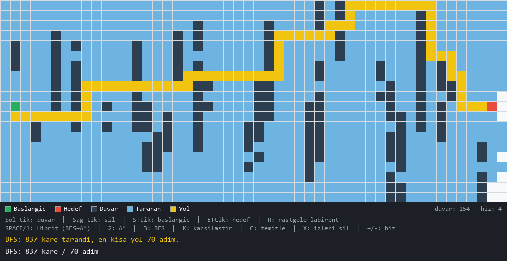
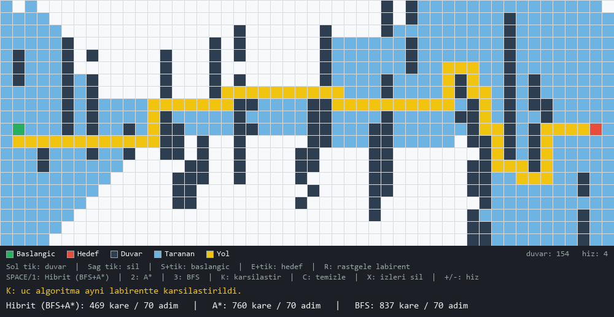

# Labirentte Yol Bulan Ajan

20x50'lik bir izgara labirentte en kısa yolu bulan, aramayı ve bulunan yolu adım adım
animasyonla gösteren `pygame` uygulaması. Labirent fareyle çizilir; üç farklı arama
yöntemi (**Hibrit BFS+A\***, **A\***, **BFS**) aynı labirent üzerinde çalıştırılıp kaç
kareye baktıkları karşılaştırılabilir.


---

## İçindekiler

- [Ödev gereksinimleri](#ödev-gereksinimleri)
- [Kurulum](#kurulum)
- [Çalıştırma](#çalıştırma)
- [Kontroller](#kontroller)
- [Ekran düzeni](#ekran-düzeni)
- [Ekran görüntüleri](#ekran-görüntüleri)
- [Algoritmalar](#algoritmalar)
- [Karşılaştırma sonuçları](#karşılaştırma-sonuçları)
- [Testler](#testler)
- [Proje yapısı](#proje-yapısı)
- [Tasarım notları](#tasarım-notları)

---

## Ödev gereksinimleri

| # | İstenen | Durum | Nerede |
|---|---------|:-----:|--------|
| 1 | Grid labirent, başlangıç ve hedef noktası | ✅ | `grid_manager.py` → `Grid`, `Node` |
| 1 | Fareyle duvar ekleme | ✅ | `main.py` → `App.handle_mouse` (sol tık ekler, sağ tık siler, sürükleme destekli) |
| 1 | En az 8 engel | ✅ | `main.py` → `MIN_WALLS = 8`; eşik sağlanmadan arama başlamaz |
| 1 | En az 20x50 kare | ✅ | `main.py` → `ROWS = 20`, `COLS = 50` (1000 hücre) |
| 2 | BFS + dinamik yol üreten başka bir algoritmayla **hibrit** yöntem | ✅ | `algorithms.hybrid_bfs_astar` → ileri yönde BFS, geri yönde A\* ile çift yönlü arama |
| 2 | En kısa yolu bulma | ✅ | Üç algoritmanın da optimalliği testlerle doğrulandı (`tests/test_algorithms.py`) |
| 3 | Aramanın animasyonla gösterilmesi | ✅ | Taranan kareler mavi dolar (`ANIMATING_VISITED`) |
| 3 | Bulunan yolun animasyonla gösterilmesi | ✅ | Yol sarı çizilir (`ANIMATING_PATH`) |
| 🎁 | **Bonus:** A\* algoritması | ✅ | `algorithms.astar` (Manhattan sezgiseli) |
| 🎁 | **Bonus:** kaç kareye baktıklarının karşılaştırılması | ✅ | Uygulamada `K` tuşu; toplu ölçüm için `benchmark.py` |

---

## Kurulum

Gereksinim: **Python 3.9+** (geliştirme ve test ortamı: Python 3.13).

```bash
# Proje klasöründe
python -m venv venv

# Windows
venv\Scripts\activate
# macOS / Linux
source venv/bin/activate

pip install -r requirements.txt
```

Tek bağımlılık `pygame==2.6.1`'dir.

## Çalıştırma

```bash
python main.py          # grafik arayüz
python benchmark.py     # arayüzsüz karşılaştırma (konsol)
```

---

## Kontroller

| Tuş / Fare | İşlev |
|---|---|
| **Sol tık / sürükle** | Duvar çiz |
| **Sağ tık / sürükle** | Duvar sil |
| **S + sol tık** | Başlangıç noktasını taşı |
| **E + sol tık** | Hedef noktasını taşı |
| **SPACE** veya **1** | Hibrit (BFS+A\*) aramasını çalıştır |
| **2** | A\* aramasını çalıştır |
| **3** | BFS aramasını çalıştır |
| **K** | Üç algoritmayı aynı labirentte çalıştır ve karşılaştır (animasyonsuz) |
| **R** | Rastgele, çözülebilir labirent üret |
| **C** | Her şeyi temizle (duvarlar + izler) |
| **X** | Sadece arama izlerini sil, labirenti koru |
| **+ / −** | Animasyon hızı (1–40 kare/çerçeve) |
| **ESC** | Çıkış |

> Not: Arama animasyonu sürerken duvar çizimi ve algoritma tuşları kilitlenir;
> `C`, `X`, hız tuşları ve `ESC` her zaman çalışır.

## Ekran düzeni

- **Üst bölüm:** labirent. Yeşil = başlangıç, kırmızı = hedef, koyu lacivert = duvar,
  mavi = taranan kare, sarı = bulunan yol.
- **Alt panel:** renk açıklamaları, duvar sayısı ve hız göstergesi, kontrol satırları,
  durum mesajı ve karşılaştırma tablosu (`algoritma: taranan kare / yol adımı`).

Aynı bilgiler konsola da yazılır, böylece sonuçlar rapora kopyalanabilir.

## Ekran görüntüleri

Aşağıdaki kareler **aynı labirent** üzerinde alınmıştır (20x50, 154 duvar);
mavi alan algoritmanın baktığı kareleri, sarı çizgi bulunan en kısa yolu gösterir.
Üç algoritma da **70 adımlık aynı yolu** bulur, fark taranan kare sayısındadır.

### 1. Çizilen labirent (arama öncesi)



### 2. Hibrit (BFS+A\*) — 469 kare tarandı

İki cephe (başlangıçtan BFS, hedeften A\*) ortada buluştuğu için taranan alan
belirgin biçimde dardır.


### 3. A\* — 760 kare tarandı

Tek cephe hedefe doğru ilerler; sezgisel sayesinde BFS'ten dar ama hibritten geniş
bir alan tarar.



### 4. BFS — 837 kare tarandı

Sezgisel kullanmadığı için hedefin yönünü bilmez ve labirentin neredeyse tamamını
katman katman tarar.



### 5. `K` ile karşılaştırma

Tek tuşla üç algoritma aynı labirentte çalışır; alt paneldeki tablo taranan kare ve
yol adımı sayılarını yan yana gösterir.



> Görseller elle alınmaz; `docs/make_screenshots.py` uygulamanın kendi çizim kodunu
> penceresiz (headless) çalıştırarak üretir, bu yüzden her zaman koddaki davranışı
> yansıtır:
>
> ```bash
> python docs/make_screenshots.py                     # varsayılan: --seed 3 --density 0.15
> python docs/make_screenshots.py --seed 11 --density 0.3
> ```

---

## Algoritmalar

Üçü de 4 yönlü (yukarı/aşağı/sol/sağ) hareket ve birim adım maliyeti varsayar;
bu nedenle bulunan yol **adım sayısı olarak** en kısadır ve üç yöntem her zaman
aynı uzunlukta yol döndürür.

`algorithms.py` modülü `pygame`'den tamamen bağımsızdır: yalnızca
`grid.rows`, `grid.cols`, `grid.get_node(r, c)`, `node.get_pos()` ve `node.is_wall()`
arayüzünü bekler. Bu sayede algoritmalar arayüz açmadan test edilebilir.

Her fonksiyon aynı kaydı döndürür:

```python
SearchResult(name, visited_order, path, examined)
# visited_order -> taranan kareler (animasyon sırası)
# path          -> başlangıçtan hedefe düğüm listesi (yol yoksa boş)
# examined      -> kaç kareye bakıldı (karşılaştırma metriği)
```

### 1. BFS — referans

Genişlik öncelikli arama; hedefi katman katman tarar. Birim maliyetli izgarada
en kısa yolu garanti eder ama sezgisel kullanmadığı için hedefin yönünü bilmez ve
geniş bir alanı tarar. Projede **doğruluk referansı** olarak kullanılır.

### 2. A\* — bonus

`f(n) = g(n) + h(n)` değerine göre öncelik kuyruğu kullanır; `h` olarak **Manhattan
uzaklığı** alınır. 4 yönlü birim maliyetli izgarada bu sezgisel hem *admissible*
hem *consistent* olduğundan bulunan yol optimaldir. Aramayı hedefe doğru
yönlendirdiği için BFS'ten belirgin biçimde az kare tarar.

### 3. Hibrit BFS + A\* — istenen ana yöntem

İki aramanın aynı anda, zıt yönlerden koştuğu **çift yönlü** bir yöntemdir:

- **İleri cephe** başlangıçtan **BFS** ile katman katman büyür. Sıralı ilerlediği için
  kuyruğunun başı her zaman o anki katman derinliğini (`min g`) verir.
- **Geri cephe** hedeften **A\*** ile başlangıca doğru, Manhattan sezgiseli güdümünde
  ilerler.
- Cepheler dengeli büyüsün diye her adımda derinliği (`min g`) küçük olan taraf
  genişletilir.
- İki cephe karşılaştığında aday bir yol uzunluğu (`best`) elde edilir. Arama hemen
  durmaz; **iki alt sınırın en büyüğü** kullanılarak durdurulur:

  1. `min g (ileri) + min g (geri)` — klasik çift yönlü sınır
  2. `min f (geri)` — A\* sınırı

  Her ikisi de gerçek en kısa mesafenin alt sınırı olduğundan maksimumu da alt
  sınırdır. `best <= sınır` olduğu anda daha kısa bir yol kalmadığı kesinleşir.

Bu durma koşulu iki şeyi birden sağlar:

- **Doğruluk:** çift yönlü aramalarda sık yapılan "ilk karşılaşmada dur" hatası
  (gerçek en kısa yoldan 1 adım uzun yol) oluşmaz.
- **Hız:** sınırın içine A\*'ın `f` değeri de girdiği için kör BFS cephesi gereksiz
  yere tüm haritayı taramak zorunda kalmaz.

Çift yönlü arama, tek yönlü aramanın taradığı `O(b^d)` alanı iki kez `O(b^(d/2))`
alana indirir; pratikte seyrek labirentlerde BFS'in taradığı karelerin yaklaşık
%20–56'ine bakar.

---

## Karşılaştırma sonuçları

Uygulamada **K** tuşu, o anki labirentte üç algoritmayı da çalıştırıp taranan kare
sayılarını panelde ve konsolda gösterir. `benchmark.py` ise aynı ölçümü çok sayıda
rastgele labirent üzerinde yapar:

```bash
python benchmark.py --runs 200
python benchmark.py --rows 30 --cols 60 --density 0.3 --runs 200 --seed 7
```

Örnek çıktı (20x50, duvar yoğunluğu %25, 200 rastgele labirent, çözülebilir 179):

```
Algoritma          ort. taranan     ort. yol ort. sure(ms)     en iyi
------------------------------------------------------------------------------
Hibrit (BFS+A*)           370.7         63.8        0.912         85
A*                        360.1         63.8        0.630         94
BFS                       712.4         63.8        0.646          0
------------------------------------------------------------------------------
Hibrit (BFS+A*) BFS'e gore %48.0 daha az kareye bakti.
A* BFS'e gore %49.5 daha az kareye bakti.
Yol uzunlugu tutarsizligi: 0
```

Farklı yoğunluklarda ortalama taranan kare sayısı:

| Labirent | Yoğunluk | BFS | A\* | Hibrit (BFS+A\*) |
|---|:--:|--:|--:|--:|
| 20x50 | %10 | 857.6 | 190.6 | **186.1** |
| 20x50 | %25 | 712.4 | **360.1** | 370.7 |
| 30x60 | %30 | 1160.9 | **606.9** | 645.4 |

Okuma notları:

- **Yol uzunluğu her üç algoritmada da aynıdır** (tablodaki "ort. yol" sütunu ve
  "tutarsızlık: 0" satırı); yani hız kazancı en kısa yoldan ödün verilerek
  elde edilmiyor.
- Boş/seyrek labirentlerde hibrit yöntem A\*'ı da geçer, çünkü iki cephe ortada
  buluşarak taranan alanı küçültür.
- Duvarlar yoğunlaştıkça hibrit ile A\* başa baş gelir: dar koridorlar BFS
  cephesinin ilerlemesini yavaşlatırken A\*'ın sezgiseli daha avantajlı olur.
- BFS her koşulda en çok kareye bakan yöntemdir — sezgisel kullanmamanın bedeli.

---

## Testler

Algoritmalar `pygame` gerektirmeden, sahte (fake) bir izgara üzerinde test edilir:

```bash
python -m unittest discover -s tests -v
```

Kapsanan durumlar:

- Elle yazılmış labirentte üç algoritmanın da **geçerli** yol döndürmesi
  (yol başlangıçta başlar, hedefte biter, duvara girmez, her adım komşu karedir).
- Üç algoritmanın **aynı uzunlukta** yol bulması.
- Yol olmayan labirentte üçünün de boş yol döndürmesi.
- `başlangıç == hedef` sınır durumu.
- 60 rastgele labirentte A\* ve hibrit yöntemin **BFS'in bulduğu en kısa yol
  uzunluğunu yakalaması** (optimallik).
- Sezgisel yöntemlerin ortalamada BFS'ten **daha az kareye bakması**.

---

## Proje yapısı

```
maze_solver_agent/
├── main.py                    # pygame arayüzü, durum makinesi, animasyon döngüsü
├── algorithms.py              # BFS, A*, Hibrit BFS+A* (pygame'den bağımsız)
├── grid_manager.py            # Node / Grid modeli, fare düzenleme, rastgele labirent, çizim
├── benchmark.py               # arayüzsüz toplu karşılaştırma aracı
├── tests/
│   └── test_algorithms.py     # doğruluk, optimallik ve verimlilik testleri
├── requirements.txt
└── README.md
```

### Sorumluluk dağılımı

- **`grid_manager.py`** labirentin *durumunu* tutar. Her hücrenin mantıksal durumu
  (`empty` / `wall` / `start` / `end`) ile animasyon rengi (`overlay`) ayrıdır; bu yüzden
  `X` ile izler silinirken labirent bozulmaz.
- **`algorithms.py`** saf arama mantığıdır; çizimden ve `pygame`'den habersizdir.
- **`main.py`** olay döngüsü ve `IDLE → ANIMATING_VISITED → ANIMATING_PATH → IDLE`
  durum makinesini yürütür. Arama tek seferde bitirilip tarama sırası bir kuyruğa
  alınır, animasyon bu kuyruğu çerçeve başına `speed` kadar tüketir; böylece ekran
  arama sırasında donmaz.

---

## Tasarım notları

- **Rastgele labirent üretimi** (`R`) dikey engel blokları yerleştirir ve her blokta
  bir geçit bırakır. Üretilen labirentin çözülebilir olduğu BFS ile doğrulanır;
  çözülemezse yeni labirent denenir (en fazla 40 deneme).
- **Başlangıç/hedef taşıma** (`S`/`E` + tık) hedefin başlangıcın üzerine taşınmasını
  engeller, taşıma sonrası eski arama izleri temizlenir.
- **En az 8 duvar kuralı** arama tuşlarında kontrol edilir; sağlanmazsa panelde
  kaç duvar olduğu ve ne yapılması gerektiği yazar.
- Algoritmalarda düğümler nesne kimliğiyle (`is`, `dict`/`set` anahtarı) karşılaştırılır;
  `Node` sınıfı `__slots__` kullanır, bu da 1000+ hücrede bellek ve erişim maliyetini düşürür.
